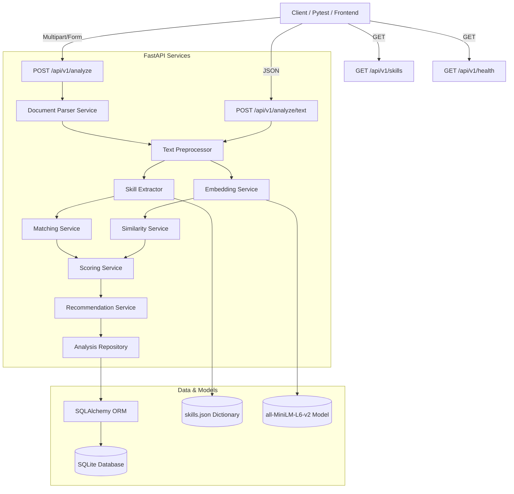

# AI Resume & Job Description Analyzer

An enterprise-grade, production-ready Python REST API that analyzes candidate resumes against job descriptions. It extracts technical skills, matches them (canonically and semantically), evaluates document-level semantic similarity, and generates compatibility scores alongside actionable gap recommendation reports.

> [!IMPORTANT]
> **Disclaimer**: This system is designed as an automated compatibility signal to assist with resume screening. It is **NOT** a final hiring decision engine and should not be used to replace human judgement in recruitment.

---

## Architecture Diagram



---

## Features

- **Multi-Format Extraction**: Parsers for PDF (PyMuPDF), DOCX (python-docx), and TXT files, with size and integrity validation.
- **Advanced Preprocessing**: Smart text cleaning, whitespace normalization, and joining of words split across newlines.
- **Categorized Skill Extraction**: Token-aware matching supporting abbreviations and special symbols (e.g. `C++`, `C#`, `.NET`, `Node.js`).
- **Semantic Matching**: High-confidence cosine similarity matching for skills that aren't exact lexical matches (e.g., `Amazon Web Services` and `AWS Cloud`).
- **Dual Semantic Embeddings**: Documents are compared using the `all-MiniLM-L6-v2` Sentence Transformer model for high-level context comparison.
- **Grounded Recommendations**: Concrete gap analysis reports mapping missing skills to constructive advice, without inventing candidate experience.
- **Persisted Analyses**: Complete history caching using SHA-256 hashes to prevent redundant processing.
- **Security-First Design**: Custom exception mapping, path traversal sanitization, upload size caps, and secure logging omitting candidate text.

---

## Technology Stack

- **Python 3.11+**
- **FastAPI** & **Uvicorn**
- **Sentence-Transformers** (all-MiniLM-L6-v2) & **PyTorch**
- **SQLAlchemy** & **SQLite**
- **PyMuPDF** & **python-docx**
- **Pydantic v2** & **Pydantic Settings**
- **scikit-learn** & **Numpy**
- **pytest** & **httpx**
- **Docker** & **Docker Compose**

---

## Project Structure

```text
├── app/
│   ├── api/
│   │   ├── routes/
│   │   │   ├── analyze.py
│   │   │   ├── health.py
│   │   │   ├── jobs.py
│   │   │   └── skills.py
│   │   └── __init__.py
│   ├── core/
│   │   ├── exceptions.py
│   │   ├── logging_config.py
│   │   └── security.py
│   │   └── __init__.py
│   ├── models/
│   │   ├── analysis.py
│   │   ├── database.py
│   │   └── __init__.py
│   ├── repositories/
│   │   ├── analysis_repository.py
│   │   └── __init__.py
│   ├── schemas/
│   │   ├── analysis.py
│   │   ├── common.py
│   │   ├── skills.py
│   │   └── __init__.py
│   ├── services/
│   │   ├── analysis_service.py
│   │   ├── document_parser.py
│   │   ├── embedding_service.py
│   │   ├── matching_service.py
│   │   ├── recommendation_service.py
│   │   ├── scoring_service.py
│   │   ├── similarity_service.py
│   │   ├── text_preprocessor.py
│   │   └── __init__.py
│   ├── utils/
│   │   ├── text_utils.py
│   │   └── __init__.py
│   ├── config.py
│   └── main.py
├── data/
│   └── skills.json
├── sample_data/
│   ├── sample_job_description.txt
│   ├── sample_resume.pdf
│   └── sample_resume.txt
├── tests/
│   ├── test_analysis_api.py
│   ├── test_database.py
│   ├── test_embedding.py
│   ├── test_health.py
│   ├── test_integration.py
│   ├── test_matching.py
│   ├── test_parser.py
│   ├── test_preprocessor.py
│   ├── test_recommendations.py
│   ├── test_scoring.py
│   ├── test_similarity.py
│   ├── test_skill_extractor.py
│   └── test_validation.py
├── Dockerfile
├── docker-compose.yml
├── requirements.txt
├── .env.example
└── .env
```

---

## Installation & Setup

### 1. Virtual Environment Setup
Ensure you have Python 3.11 installed. Create a virtual environment and upgrade pip:
```bash
python3.11 -m venv .venv
source .venv/bin/activate
pip install --upgrade pip
```

### 2. Install Dependencies
```bash
pip install -r requirements.txt
```

### 3. Environment Configuration
Copy the `.env.example` file and configure variables:
```bash
cp .env.example .env
```
Default configuration inside `.env`:
```ini
APP_NAME="AI Resume & Job Description Analyzer"
APP_ENV=local
MODEL_NAME="all-MiniLM-L6-v2"
DATABASE_URL="sqlite:///./data/resume_analyzer.db"
MAX_FILE_SIZE_MB=10
MAX_TEXT_LENGTH=50000
SKILL_MATCH_WEIGHT=0.60
SEMANTIC_WEIGHT=0.40
LOG_LEVEL=INFO
```

---

## Running the Application

### 1. Running Locally
Start the development server:
```bash
uvicorn app.main:app --reload --host 0.0.0.0 --port 8000
```
- Interactive Swagger API Docs: [http://localhost:8000/docs](http://localhost:8000/docs)
- Alternative ReDoc API Docs: [http://localhost:8000/redoc](http://localhost:8000/redoc)

### 2. Running with Docker
Run the complete application in a self-contained container:
```bash
docker compose up --build
```
*Note: The Dockerfile pre-downloads the SentenceTransformer weights during the build phase so container starts immediately and requires no internet access at runtime.*

---

## Running Tests

Execute the complete 49-test suite with pytest:
```bash
pytest
```

---

## Scoring Formula

The system uses a transparent, configurable compatibility formula:

1. **Skill Match Score ($S_{\text{skill}}$)**:
   $$S_{\text{skill}} = \left( \frac{\text{Matched Job Skills}}{\text{Total Job Skills}} \right) \times 100$$
   *Note: Bounded to 100.0 if the job description contains no detectable skills.*

2. **Semantic Similarity Score ($S_{\text{semantic}}$)**:
   Calculates the cosine similarity between the full preprocessed resume text embedding and the job description embedding, normalized to $0 - 100$.

3. **Overall Compatibility Score ($S_{\text{overall}}$)**:
   $$S_{\text{overall}} = (w_{\text{skill}} \times S_{\text{skill}}) + (w_{\text{semantic}} \times S_{\text{semantic}})$$
   
Weights are fully configurable via settings (defaults are $w_{\text{skill}} = 0.60$, $w_{\text{semantic}} = 0.40$).

---

## API Endpoints Reference

### GET `/api/v1/health`
Verifies service status.
**Example Request**:
```bash
curl -X GET http://localhost:8000/api/v1/health
```
**Response (200 OK)**:
```json
{
  "status": "healthy",
  "service": "resume-job-analyzer"
}
```

---

### POST `/api/v1/analyze`
Accepts a resume file and a job description.
**Example Request**:
```bash
curl -X POST http://localhost:8000/api/v1/analyze \
  -F "resume_file=@sample_data/sample_resume.pdf" \
  -F "job_description=Seeking a Senior Python engineer with FastAPI, Docker, PostgreSQL and AWS experience."
```
**Response (200 OK)**:
```json
{
  "analysis_id": "893d9ce7-59d4-4cf0-a61b-932f913d8abe",
  "semantic_similarity_score": 78.4,
  "skill_match_score": 75.0,
  "overall_score": 77.04,
  "resume_skills": ["docker", "fastapi", "machine learning", "mysql", "natural language processing", "python", "sentence transformers"],
  "job_required_skills": ["amazon web services", "docker", "fastapi", "postgresql", "python"],
  "matched_skills": ["docker", "fastapi", "python"],
  "missing_skills": ["amazon web services", "postgresql"],
  "additional_skills": ["machine learning", "mysql", "natural language processing", "sentence transformers"],
  "recommendations": [
    "Highlight your cloud infrastructure, deployment, or architecture experience using AWS if applicable.",
    "Mention database modeling, optimization, or queries involving PostgreSQL if you have hands-on experience."
  ],
  "score_breakdown": {
    "skill_match_weight": 0.6,
    "semantic_similarity_weight": 0.4
  },
  "explainable_matches": {
    "python": {
      "matched_to_resume_skill": "python",
      "similarity_score": 100.0,
      "match_type": "exact"
    },
    "fastapi": {
      "matched_to_resume_skill": "fastapi",
      "similarity_score": 100.0,
      "match_type": "exact"
    },
    "docker": {
      "matched_to_resume_skill": "docker",
      "similarity_score": 100.0,
      "match_type": "exact"
    }
  }
}
```

---

### POST `/api/v1/analyze/text`
Accepts raw text payloads directly.
**Example Request**:
```bash
curl -X POST http://localhost:8000/api/v1/analyze/text \
  -H "Content-Type: application/json" \
  -d '{
    "resume_text": "Python backend dev with FastAPI and MySQL.",
    "job_description": "FastAPI engineer with Python and PostgreSQL."
  }'
```

---

### GET `/api/v1/analysis/{analysis_id}`
Returns a stored analysis record by ID.
**Example Request**:
```bash
curl -X GET http://localhost:8000/api/v1/analysis/893d9ce7-59d4-4cf0-a61b-932f913d8abe
```

---

### GET `/api/v1/skills`
Returns a flat list of all supported skills.
**Example Request**:
```bash
curl -X GET http://localhost:8000/api/v1/skills
```

---

### GET `/api/v1/skills/categories`
Returns supported skills grouped by category.
**Example Request**:
```bash
curl -X GET http://localhost:8000/api/v1/skills/categories
```

---

## Limitations

1. **Static Taxonomy**: The system uses a predefined skill dictionary (`skills.json`). If a new technology is not in the taxonomy, it won't be explicitly extracted as a skill, though its semantic influence will be reflected in the overall document-level similarity.
2. **Context-Insensitive Preprocessing**: The system uses regex mapping and token-aware parsing to map spelling variations. Extremely complex phrasing may lead to false positives/negatives in rare edge cases.
3. **No Temporal Weighting**: The system extracts skills statically. It does not differentiate between a skill used for 5 years and one used in a single tutorial.

---

## Future Improvements

1. **Dynamic Synonyms with LLMs**: Integrate a localized generative model to automatically expand the `skills.json` alias registry.
2. **Experience Duration Extraction**: Parse date ranges and calculate years of experience per matched skill to create an experience-weighted score.
3. **Section-Level Similarity Weighting**: Extract separate weights for different sections (e.g. higher weights for "Experience" compared to "Education").
